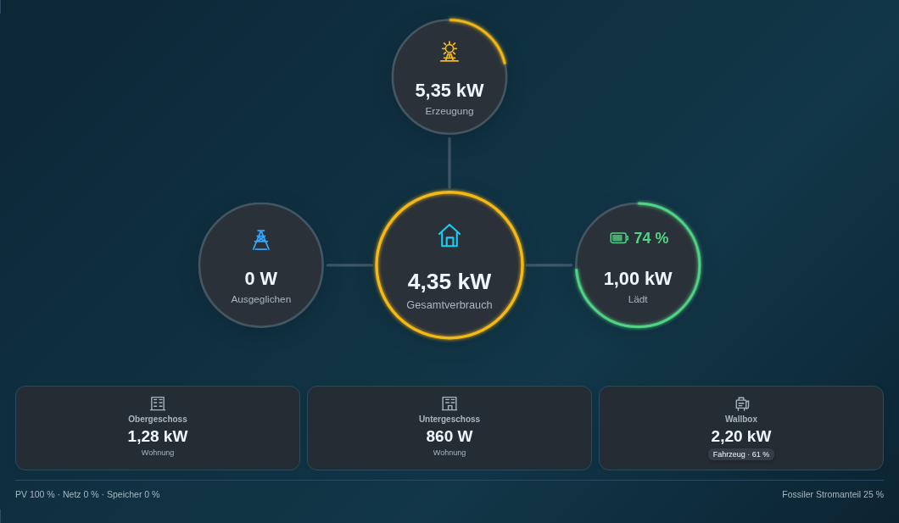
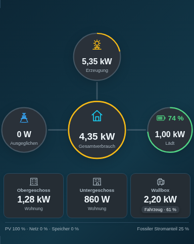

# EMH Power Flow Card

**Visualisierung des Energieflusses in Home Assistant – für Photovoltaik, Stromnetz, Batteriespeicher, Haus und bis zu sechs individuelle Verbraucher.**

Die EMH Power Flow Card ist eine eigenständige Lovelace-Custom-Card von **EMH – Effiziente Energielösungen**. Sie stellt die aktuellen Leistungsflüsse übersichtlich dar, berechnet den Hausverbrauch aus Messwerten und zeigt die geschätzte Herkunft des verbrauchten Stroms. Die Karte besitzt einen grafischen Home-Assistant-Konfigurationseditor und ist für Desktop und Mobilgeräte ausgelegt.






## Funktionen im Überblick

- **Vier Haupt-Kacheln:** PV oben, Netz links, Batteriespeicher rechts, Haus in der Mitte. Runde Kacheln mit konfigurierbaren Außenringen und Statuszeilen.
- **Hausverbrauch:** Automatische Berechnung aus PV-Erzeugung, Netzbezug, Einspeisung, Batterieentladung und Batterieladung; einzelne Individual-Verbraucher können optional abgezogen werden.
- **Energieherkunft:** Dreifarbiger Hausring für PV (Gelb), Netz (Blau) und Batterie (Grün); prozentuale Aufteilung zusätzlich in der optionalen Fußzeile.
- **Netzlastwarnung:** Der Netzring wechselt ab einer konfigurierbaren Lastschwelle auf eine frei einstellbare Warnfarbe.
- **Batterieanzeige:** Ladezustand (SOC) neben dem Batteriesymbol, dynamische Symbolfüllung, optional SOC-abhängige Symbol-/Textfarbe. Die äußere Ringfarbe bleibt separat einstellbar.
- **Auslastungsringe:** Ringwert und Höchstwert wahlweise fest oder über Entitäten, Auswahl zwischen Leistungs- und SOC-Ring für den Speicher sowie einstellbare Ringbreite.
- **Animierter Energiefluss:** Lichtpunkte, Kometen, Impulse oder fließende Striche; Richtungsanzeige für Netz und Batterie. Geschwindigkeit unabhängig von der aktuellen Leistung.
- **Bis zu sechs Individual-Kacheln:** Drei pro Reihe; je Kachel Haupt-Entität, Bezeichnung, Symbol, Zusatzzeile, Einheit, Schwellwerte, Aktiv-Hervorhebung, Multiplikator, Erzeuger-Modus und Navigation.
- **Status und Informationen:** LIVE-/Teilstatus und Hilfe-Button rechts oben. Unter der Grafik optionale Fußzeile mit Energieanteilen und dem fossilen Stromanteil.
- **Grafischer Konfigurationseditor:** Entitätsauswahl, Auswahlfelder, native Farbwähler mit HEX-Eingabe und erweiterbare Bereiche für alle wesentlichen Optionen.
- **Darstellung:** Automatische, helle oder dunkle Farbgebung; transparenter Kartenhintergrund; kompakte Mobilansicht; Animation mit optionalem Energiesparmodus.
- **Navigation:** Lovelace-Pfade, Hash-Links (z. B. Popups) und externe HTTP(S)-Adressen.

**Wichtig:** Die Card visualisiert und berechnet Leistungen. Sie steuert keine Wechselrichter oder Wallboxen und begrenzt keine Netzleistung. Die angezeigten Energieherkunftsanteile sind ohne separate Herkunftssensoren eine Näherung.

## Voraussetzungen

- Home Assistant mit Lovelace-Dashboard und den gewünschten Sensor-Entitäten.
- Für den grafischen Editor: Dashboard im UI-Bearbeitungsmodus.
- Optional: HACS bzw. Home Assistant Marketplace für Installation und Updates.
- Popups über Hash-Links erfordern eine passende Popup-Lösung im Dashboard; die Card selbst stellt nur die Navigation bereit.

Es ist keine eigene Home-Assistant-Integration und kein separates Backend erforderlich.

## Installation

### Über HACS / Marketplace

1. Den öffentlichen GitHub-Repository-Inhalt unter dem Namen `emh-power-flow-card` veröffentlichen.
2. In HACS **Benutzerdefinierte Repositories** öffnen, die GitHub-Repository-URL einfügen und als Typ **Dashboard** hinzufügen. Bei Home-Assistant-Versionen mit neuem Marketplace erfolgt dies über dessen Funktion **Add from link**.
3. Die Card installieren. HACS bzw. Marketplace übernimmt in üblichen UI-verwalteten Dashboards die JavaScript-Ressource automatisch.
4. Dashboard neu laden und Karte mit `type: custom:emh-power-flow-card` hinzufügen.

Die installierte Datei liegt bei HACS typischerweise unter `www/community/emh-power-flow-card/`. Der HACS-Ressourcenpfad ist üblicherweise `/hacsfiles/emh-power-flow-card/emh-power-flow-card.js`; neue Marketplace-Versionen können eine `/local/community/...`-Ressource mit Versionsparameter einrichten.

**Keine zweite manuelle Ressource für dieselbe Card aktivieren**, wenn HACS oder Marketplace sie bereits automatisch registriert hat.

### Manuell

1. `emh-power-flow-card.js` nach `/config/www/` kopieren.
2. In **Einstellungen → Dashboards → Ressourcen** eine JavaScript-Modul-Ressource anlegen:

   ```text
   /local/emh-power-flow-card.js?v=1.0.0
   ```

3. Alte Ressourcen derselben Card entfernen, das Dashboard neu laden und bei Bedarf den App-Cache aktualisieren.

### Erste Card hinzufügen

```yaml
type: custom:emh-power-flow-card
```

Der grafische Editor bietet anschließend alle Konfigurationsgruppen. Die Vorlage enthält Beispiel-Entitäten, die an die eigene Home-Assistant-Installation angepasst werden müssen.

## Grundkonfiguration

```yaml
type: custom:emh-power-flow-card
theme: auto
min_flow_w: 0
appearance:
  transparent_background: true
  ring_width_percent: 50
entities:
  pv: sensor.pv_power
  grid_mode: separate
  grid_import: sensor.grid_import
  grid_export: sensor.grid_export
  battery_mode: separate
  battery_charge: sensor.battery_chargepower
  battery_discharge: sensor.battery_dischargepower
  battery_soc: sensor.battery_soc
  fossil: sensor.electricity_maps_anteil_fossiler_energietrager
nodes:
  grid:
    ring_max: 5000
    alert_threshold_w: 5000
    alert_from_percent: 90
    alert_color: "#f04b54"
  battery:
    ring_source: soc
    use_soc_colors: true
animation:
  style: dots
  speed: 1
  glow: 65
  max_drops: 3
  mobile_power_save: true
  mobile_fps: 25
  mobile_max_particles: 2
display:
  footer: true
  energy_split: true
  fossil: true
  live: true
  info_button: true
```

Die Konfiguration kann über den Editor oder direkt in YAML erfolgen. Bei der Konfiguration von Einzel-Kacheln (`nodes`) reichen die Felder, die vom Standard abweichen; Standardwerte werden automatisch ergänzt.

## Entitäten und Leistungsquellen

In der Einstellungsgruppe **Haupt-Kacheln** werden die Messwerte zugeordnet.

| Feld | Funktion |
|---|---|
| `entities.pv` | Aktuelle PV-Erzeugung |
| `entities.grid_mode` | `separate` für zwei Netz-Entitäten oder `signed` für eine vorzeichenbehaftete Entität |
| `entities.grid_import`, `entities.grid_export` | Netzbezug und Einspeisung, jeweils als positiver Leistungswert |
| `entities.grid_power` | Vorzeichenbehaftete Netzleistung bei `grid_mode: signed` |
| `entities.grid_invert_sign` | Vorzeichen des Netzsensors umkehren |
| `entities.battery_mode` | `separate` oder `signed` für die Batterieleistung |
| `entities.battery_charge`, `entities.battery_discharge` | Positive Lade- bzw. Entladeleistung |
| `entities.battery_power` | Vorzeichenbehaftete Batterieleistung bei `battery_mode: signed` |
| `entities.battery_invert_sign` | Vorzeichen des Batteriesensors umkehren |
| `entities.battery_soc` | Batterieladezustand in Prozent |
| `entities.fossil` | Optionaler prozentualer Anteil fossiler Stromerzeugung für die optionale Fußzeile |
| `entities.pv_to_home` | Optionaler Direktwert PV → Haus |
| `entities.grid_to_home` | Optionaler Direktwert Netz → Haus |
| `entities.battery_to_home` | Optionaler Direktwert Batterie → Haus |

**Vorzeichenkonvention im `signed`-Modus:** Netz `+` = Bezug / `−` = Einspeisung. Batterie `+` = Entladung / `−` = Ladung. Bei anderen Gerätekonventionen `grid_invert_sign` oder `battery_invert_sign` aktivieren.

### Einheiten der Leistungsentitäten

Leistungen werden intern in **Watt (W)** verarbeitet. Die Card kann `W`, `kW` und `MW` aus dem Attribut `unit_of_measurement` automatisch erkennen. Falls ein Sensor keine oder eine fehlerhafte Einheit liefert, kann sie pro Leistungsquelle über den Suffix `_unit` überschrieben werden:

```yaml
entities:
  pv: sensor.pv_leistung_kw
  pv_unit: kW
  grid_import: sensor.grid_import
  grid_import_unit: auto
```

Dies gilt auch für `grid_export`, `grid_power`, `battery_charge`, `battery_discharge`, `battery_power`, `pv_to_home`, `grid_to_home` und `battery_to_home`. `auto` ist die Standardwahl. **Einheitenüberschreibung bedeutet Interpretation des Sensorwerts, keine Umrechnung der physischen Messung im Sensor.**

### Hausverbrauch und Herkunftsanteile

Die Grundberechnung lautet:

```text
Hausverbrauch (W) = PV-Erzeugung + Netzbezug + Batterieentladung
                    − Netzeinspeisung − Batterieladung
                    − explizit konfigurierte Individual-Abzüge
```

Negative Ergebnisse werden auf null begrenzt. Ist ein notwendiger Sensorwert nicht verfügbar, wird die Hausbilanz gegebenenfalls als `–` dargestellt. Die **Nulltoleranz betrifft nur die Darstellung**, nicht die zugrunde liegende Berechnung.

Für die farblichen Anteile am Hausring werden PV, Netz und Batterie unter Berücksichtigung von Export und Batterieladung abgeschätzt. Wenn alle drei optionalen Sensoren `pv_to_home`, `grid_to_home` und `battery_to_home` gültige Werte liefern, werden diese für die Herkunftsaufteilung benutzt. Die Anteile werden für die Anzeige auf 100 % normiert. Durch fehlende Strompfadmessungen, zeitliche Messabweichungen und unterschiedliche Aktualisierungsintervalle können die angezeigten Herkunftsanteile von der physikalischen Aufteilung abweichen.

**Achtung bei Individual-Abzügen:** Nur Werte abziehen, die in deiner Gesamtbilanz tatsächlich zusätzlich enthalten sind und getrennt dargestellt werden sollen. Sonst wird Verbrauch doppelt berücksichtigt. Die Card addiert Individual-Verbraucher nicht automatisch zum Hauswert.

## Haupt-Kacheln, Außenringe und Farben

`nodes.pv`, `nodes.grid`, `nodes.battery` und `nodes.home` steuern die vier runden Haupt-Kacheln. Jede Kachel unterstützt folgende Grundeinstellungen:

| Option | Beschreibung |
|---|---|
| `name` | Angezeigter Name bzw. zugängliche Bezeichnung |
| `icon` | Symbol, z. B. `mdi:solar-power` oder `mdi:home` |
| `color` | Hauptfarbe im HEX-Format `#RRGGBB`; Auswahl auch per Farbwähler |
| `popup` | Popup-Hash, interner Lovelace-Pfad oder externe URL |
| `zero_tolerance_w` | Werte unter dieser Leistung werden als 0 W angezeigt |
| `show` | Kachel ein- oder ausblenden |

### Leistungsringe für PV, Netz und Batterie

| Option | Beschreibung |
|---|---|
| `ring_entity` | Sensor für die Füllung des Rings |
| `ring_max_mode` | `fixed` (fester Maximalwert) oder `entity` (Maximalwert aus Entität) |
| `ring_max` | Fester Wert für 100 % Füllung |
| `ring_max_entity` | Entität für den 100-%-Referenzwert |
| `ring_unit` | Einheit des festen Ringmaximums: `W`, `kW`, bei passender Messgröße auch `%` |
| `ring_max_entity_unit` | Einheit der Entität für das Ringmaximum |
| `ring_value_unit` | Einheit des Ringwerts, falls Home Assistant keine passende Einheit meldet |

Mit `appearance.ring_width_percent` wird die Ringbreite relativ zum ursprünglichen Standard bestimmt. `50` bedeutet halbe Breite; zulässige Werte werden intern begrenzt.

**Batteriespezifisch:**

- `nodes.battery.ring_source`: `soc` für Ladezustand, `power` für Lade-/Entladeleistung, `custom` für eine eigene Ring-Entität.
- `nodes.battery.icon_style`: `horizontal` für ein liegendes Symbol mit SOC-Füllung oder `classic` für das eingestellte MDI-Symbol.
- `nodes.battery.use_soc_colors`: Färbt optional **nur Symbol und SOC-Prozenttext** nach dem Ladezustand. Die Außenringfarbe bleibt unter `nodes.battery.color` fest konfiguriert.
- `nodes.battery.power_ring_max_mode`: `fixed` oder `entity` bei `ring_source: power`.
- `nodes.battery.power_ring_max`, `power_ring_unit`: Referenzleistung im festen Modus.
- `nodes.battery.power_ring_max_entity`, `power_ring_max_entity_unit`: Referenzleistung aus Entität.

Beim Ladeleistungsring wird die Richtung durch eine invertierte Füllrichtung berücksichtigt. Der Hausring zeigt keine Kapazitätsauslastung, sondern die drei relativen Energiequellen.

### Netzlastwarnung

Unter `nodes.grid` lässt sich ein Warnring konfigurieren:

```yaml
nodes:
  grid:
    alert_entity: sensor.grid_import
    alert_threshold_mode: fixed
    alert_threshold_w: 5000
    alert_threshold_unit: W
    alert_from_percent: 90
    alert_color: "#f04b54"
```

- `alert_entity`: Messwert für die Warnung.
- `alert_threshold_mode`: Fester Grenzwert `fixed` oder dynamische Entität `entity`.
- `alert_threshold_w` / `alert_threshold_unit`: Fester Grenzwert und Einheit.
- `alert_threshold_entity` / `alert_threshold_entity_unit`: Dynamischer Grenzwert und dessen Einheit.
- `alert_from_percent`: Auslösung ab diesem Anteil des Grenzwerts, z. B. 90 %.
- `alert_color`: Frei wählbare Warnringfarbe (Farbwähler + HEX).

Die Warnfarbe dient ausschließlich als Anzeige. Es erfolgt **keine automatische Leistungsbegrenzung**.

### Zusatzzeilen der Haupt-Kacheln

PV, Netz und Batterie besitzen eine zusätzliche Statuszeile. Für `nodes.<kachel>.secondary_mode` stehen zur Verfügung:

- `default`: Standardtext aus der erkannten Situation, z. B. „Erzeugung“, „Einspeisung“, „Lädt“ oder „Entlädt“.
- `text`: Eigener Text in `secondary_text`.
- `state`: Textzustand einer Entität aus `secondary_entity`.
- `entity`: Numerischer Wert einer `secondary_entity`, wahlweise mit `secondary_label` und `secondary_unit`.

Das Haus zeigt standardmäßig „Gesamtverbrauch“ bzw. einen Hinweis auf aktivierte Individual-Abzüge.

## Individual-Kacheln (0 bis 6)

Unterhalb des Energieflusses können bis zu sechs Kacheln dargestellt werden, auf Desktop und Mobil in **drei Spalten pro Reihe**. Die Reihenfolge ist im Editor änderbar. Typische Anwendungen: Wohnungszähler, Wallboxen, Heizstäbe, Warmwasser, Wärmepumpe, Server oder weitere Verbraucher.

```yaml
individual:
  - id: og
    name: Obergeschoss
    entity: sensor.sm2_power_total_raw
    entity_unit: auto
    icon: mdi:home-floor-2
    popup: "#pop-up-og"
    secondary_mode: text
    secondary_text: Verbrauch
    multiplier: 1
    zero_tolerance_w: 10
    deduct_from_home: false
    highlight_active_enabled: false
    show: true
  - id: wallbox
    name: Wallbox
    entity: sensor.ev_charge_1_wb_chargepower
    icon: mdi:ev-station
    popup: "#pop-up-wallbox"
    secondary_mode: entity
    secondary_entity: sensor.ev_charge_1_carsoc
    secondary_label: Fahrzeug
    secondary_unit: "%"
```

| Option | Funktion |
|---|---|
| `id` | Eindeutige technische ID, für die Navigation und Aktualisierung |
| `name` | Name der Kachel |
| `entity` | Haupt-Entität mit dem Leistungswert |
| `entity_unit` | `auto`, `W`, `kW` oder `MW` für die Haupt-Entität |
| `icon` | MDI-Symbol |
| `popup` | Popup-Hash / Link |
| `secondary_mode` | `text`, `state` oder `entity` |
| `secondary_text` | Fester Zusatztext; auch Rückfalltext bei bestimmten Modi |
| `secondary_entity` | Entität für Zusatzwert oder Zustand |
| `secondary_label` | Beschriftung des Zusatzwerts |
| `secondary_unit` | Optionale Einheit des Zusatzwerts, leer = Sensor-Einheit verwenden |
| `secondary_decimals` | Dezimalstellen eines numerischen Zusatzwerts (0 bis 3) |
| `secondary_show_above_enabled` | Zusatzzeile erst oberhalb des Leistungsschwellwerts anzeigen |
| `secondary_threshold_w` | Leistungsschwelle in Watt; auch Basis für Aktiv-Hervorhebung |
| `highlight_active_enabled` | Leucht-/Schatteneffekt ab der Schwellleistung aktivieren |
| `highlight_active_color` | HEX-Farbe für die Aktiv-Hervorhebung |
| `multiplier` | Multiplikationsfaktor für den Hauptwert, Standard 1 |
| `reverse_flow` | Als Erzeuger kennzeichnen; wird nicht als Individual-Abzug des Hausverbrauchs berücksichtigt (keine eigene Flussleitung) |
| `deduct_from_home` | Individual-Leistung ausdrücklich von der berechneten Hausleistung abziehen |
| `zero_tolerance_w` | Anzeigewerte kleiner als die Toleranz auf 0 W setzen |
| `show` | Kachel ein-/ausblenden |

Für `secondary_mode: state` besitzt die Card eine integrierte Zuordnung häufiger Zustände, z. B. `on` → „Ein“, `off` → „Aus“. Mit `secondary_state_map` kann über YAML eine eigene Zustandszuordnung hinterlegt werden; im grafischen Editor ist dafür kein eigenes Eingabefeld vorhanden.

## Animation und Mobil-Performance

Die Flusswege zwischen PV, Netz, Batterie und Haus werden animiert, wenn Leistung oberhalb des eingestellten Schwellenwerts fließt. Bei Netz und Batterie wird die Richtung anhand der Vorzeichen berücksichtigt.

| Option | Funktion / übliche Werte |
|---|---|
| `animation.style` | `dots` (Lichtpunkte), `comet` (Kometen), `pulse` (Impulse), `dash` (fließende Striche) |
| `animation.speed` | Geschwindigkeit von 0 bis 3; **0 stoppt die Animation**; von der Leistung unabhängig |
| `animation.glow` | Leuchtstärke (0–100) |
| `animation.max_drops` | Maximale Anzahl bewegter Partikel (1–5) |
| `animation.mobile_power_save` | Mobilen Energiesparmodus aktivieren |
| `animation.mobile_fps` | Maximale mobile Bildrate, z. B. 25 FPS |
| `animation.mobile_max_particles` | Maximale Partikelzahl je Leitung auf Mobilgeräten |
| `min_flow_w` | Energieflussanimation erst ab dieser Leistung in Watt |

Der Energiesparmodus begrenzt Mobil-Bildrate und Partikelzahl, reduziert aufwendige Effekte und stoppt die Animation in nicht sichtbaren Ansichten. Die Geschwindigkeit auf einem einzelnen Pfad bleibt unabhängig vom Leistungswert. Bei Problemen mit einer schwachen Companion-App-Konfiguration können etwa `mobile_fps: 20` und `mobile_max_particles: 1` sinnvoll sein.

## Darstellung, Fußzeile und Hilfe

| Option | Beschreibung |
|---|---|
| `theme` | `auto`, `dark`, `light` |
| `appearance.transparent_background` | Halbtransparenter Kartenhintergrund passend zum Home-Assistant-Theme |
| `appearance.ring_width_percent` | Relative Dicke der Außenringe; Standard 50 % |
| `display.footer` | Optionale Fußzeile unter der Energieflussgrafik anzeigen |
| `display.energy_split` | Anteile von PV, Netz und Speicher in der Fußzeile anzeigen |
| `display.live` | LIVE-/Teilweise-Status rechts oben anzeigen |
| `display.fossil` | Fossilen Stromanteil in der Fußzeile anzeigen, sofern ein Sensor vorhanden ist |
| `display.info_button` | Hilfe-Button `?` anzeigen |
| `info.title` | Überschrift des Hilfe-Popups |
| `info.description` | Eigener mehrzeiliger Hilfetext |
| `info.show_default_guide` | Standarderklärung der Symbole, Ringe und Farben ein-/ausblenden |

Die Card besitzt keinen Titelbereich. Der LIVE-/Teilweise-Status und die Hilfe-Schaltfläche stehen rechts oben. Die konfigurierbare Fußzeile befindet sich unterhalb der Grafik und zeigt Energieanteile sowie optional den fossilen Stromanteil.

### Navigation

Für PV/Netz/Batterie/Haus und jede Individual-Kachel kann `popup` gesetzt werden:

- `"#pop-up-pv"` – Hash-Navigation für passende Popup-Karten.
- `"/energy"` – interner Dashboard-/Home-Assistant-Pfad.
- `"https://www.example.com"` – externe Webseite in einem neuen Tab.

Die Karte ersetzt keine Popup-Integration. Hash-Navigation hängt davon ab, wie das Dashboard den Hash interpretiert.

## Technische Hinweise

- Registrierung: `custom:emh-power-flow-card`; grafischer Editor: `emh-power-flow-card-editor`.
- Leistungswerte und Berechnungen: Watt, Anzeige in W bzw. bei größeren Werten in kW.
- Sensorausfälle: fehlende Messwerte werden nicht stillschweigend als echte Nullen behandelt.
- Ursprungsring: Anteile werden normiert und als zusammenhängende SVG-Bögen ausgegeben.
- Außenringe: Einheit, Maximum und Farbgebung für jede Haupt-Kachel separat konfigurierbar.
- Frontend: Die gesamte Card wird über eine einzige JavaScript-Datei ausgeliefert; keine zusätzlichen Laufzeitdateien erforderlich.
- Die Standard-Entitätsnamen sind Beispiele. Sie müssen nicht identisch mit den verwendeten Entitäten anderer Anlagen sein.

## GitHub-Veröffentlichung

Für einen manuellen Repository-Upload die Dateien dieses Pakets **direkt in das Stammverzeichnis** des öffentlich sichtbaren GitHub-Repositories `emh-power-flow-card` hochladen. `emh-power-flow-card.js`, `hacs.json`, `README.md` und `.github/workflows/release.yml` dürfen nicht in einem zusätzlichen übergeordneten ZIP-Verzeichnis liegen. GitHub-Uploads im Browser übernehmen versteckte `.github`-Ordner unter Umständen nicht bequem; in diesem Fall die Workflow-Datei separat über GitHub **Add file → Create new file** mit dem Pfad `.github/workflows/release.yml` hinzufügen.

Danach einen Git-Tag `v1.0.0` anlegen und den Release-Workflow ausführen lassen. Der Workflow hängt die Datei `emh-power-flow-card.js` an einen GitHub-Release an. Ein veröffentlichtes GitHub-Release ist für nachvollziehbare Updates empfehlenswert. Anschließend das Repository als benutzerdefinierte Dashboard-Quelle in HACS / Marketplace eintragen. Die Aufnahme in den **allgemeinen öffentlichen Katalog** ist ein gesonderter Prüf- und Einreichungsprozess.

**Lizenzhinweis:** In diesem Paket ist bewusst keine Lizenz eingeräumt. Vor der Veröffentlichung als Open-Source-Projekt bitte eine geeignete `LICENSE` ergänzen (z. B. MIT, wenn gewünscht). Ohne Lizenz gelten grundsätzlich die Rechte des Urhebers; öffentliche Sichtbarkeit auf GitHub ist keine Freigabe zur Weiterverwendung.

---

**EMH – Effiziente Energielösungen** · Home Assistant · Photovoltaik · Energiemonitoring


## Hinweise zur Konfigurationsoberfläche

Im Editor heißen die Bereiche **Allgemeines**, **Animation – konstante Geschwindigkeit**, **Haupt-Kacheln**, **Ringe, Farben und Lastspitzenwarnung**, **Individual-Kacheln**, **Sichtbarkeit** und **Information / Hilfe (?)**. Das Feld **Hintergrund transparent** steuert die transparente Darstellung unabhängig vom Namen des HA-Themes. Die Hausverbrauchsberechnung erfolgt automatisch aus den Messwerten; in der Karte werden die Energieanteile von PV, Netz und Batterie dargestellt.
